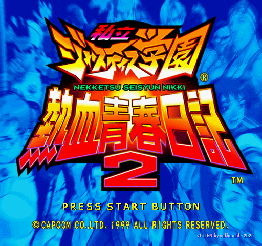
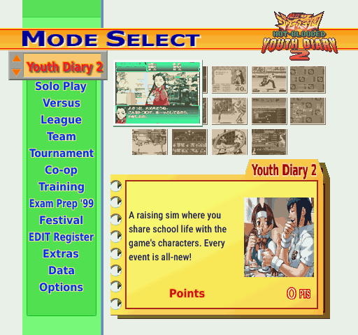
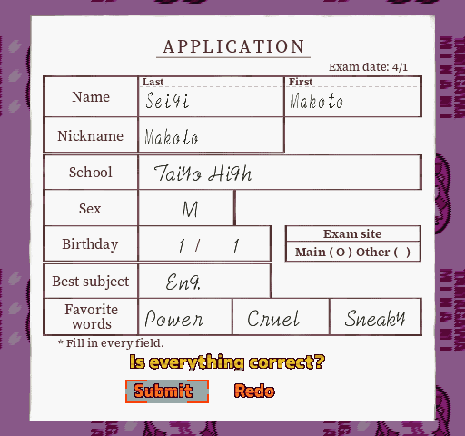
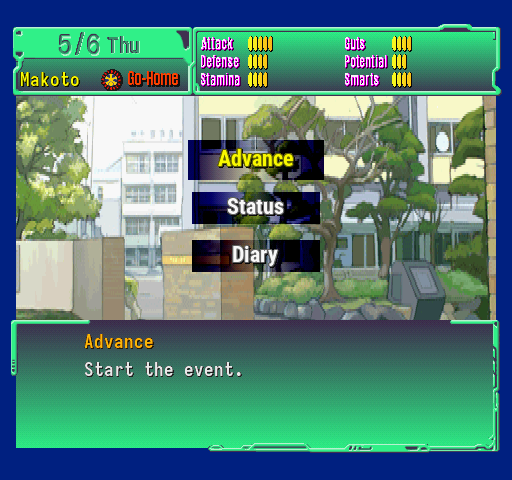
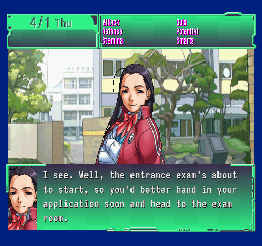
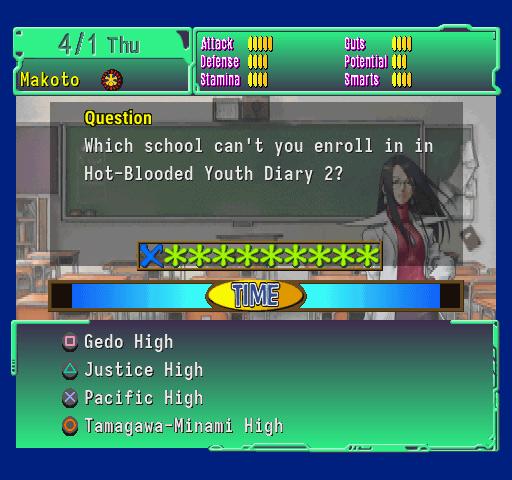
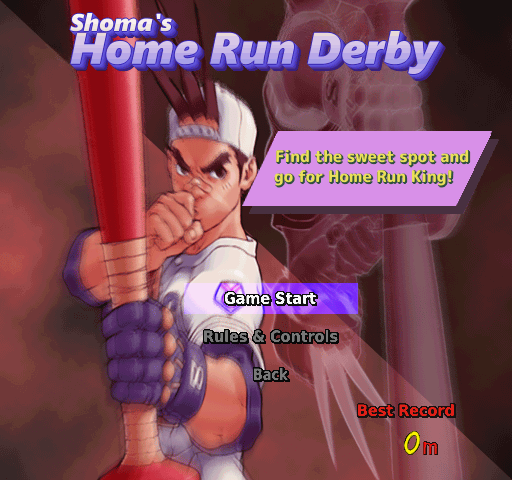

# Nekketsu Seishun Nikki 2 - English patch

Unofficial English fan translation of *Shiritsu Justice Gakuen: Nekketsu
Seishun Nikki 2* (PlayStation, Japan, SLPS-02120), the standalone sequel
to the diary mode (Hot-Blooded Youth Diary) of *Shiritsu Justice Gakuen:
Legion of Heroes*.

This repository holds no game data. You need your own dump of the disc and
have to patch it yourself.

Note: the project is LLM-assisted, with many human hours spent on editing,
playtesting and design work.

## Screenshots

  
  

  
  

  
  

  
  

## What is translated

- All diary-mode story text, for both the male and the female lead.
- Diary-mode menus, hub, calendar, status pages, map, shop and save/load
  screens, the month cards and the event cards.
- Character creation and name entry. The name entry takes Latin letters.
- The written exams, the practical exams and their graphics, and the Exam
  Prep '99 mode with its report cards.
- The Festival mini-games: menus, rules pages, title and practice cards
  and HUD.
- EDIT Register: the register screens, the password screen, CPU tactics,
  the move lists and the command cards.
- Extras: the shop, the collection and the PocketStation download,
  including the PocketStation LCD frames.
- Mode select, title menu, options and help panels, pause menus, system
  messages and the diary staff roll.
- Fight callouts in diary-mode fights, taken from the USA release.

Character names and move names follow the official Western *Rival
Schools* and *Project Justice* releases. Honorifics are kept.

Left in Japanese:

- Modes that a player can reach in an official Western release: Solo,
  Versus, Team, Co-op, League, Tournament and Training.
- The title logo and the loading-screen art, to keep the original art.
- Two KANRI memory card messages that have no text record.

## PocketStation: Pocket Justice

The disc carries a PocketStation game, *Pocket Justice*, and the patch
translates it as well: its mail text, menus and LCD screens. The game has
three mini-games (Be a Dr. K with Shoma, Photo Op with Ran, Dive Ace with
Nagare), a points wallet, and a phone mode in which a character you chose
sends you mail. You can reply to each mail, and replies raise or lower
the character's affection.

There are two ways to get it onto a PocketStation or into an emulator:

- In the patched game, Extras > PocketStation > Download writes it to a
  memory card. It needs 11 free blocks. A character becomes selectable in
  the phone mode after you finish that character's diary ending.
- `tools/mkpocket.py` in this repository writes a memory card image with
  the game, taken straight from the patched disc image:

      python3 tools/mkpocket.py --image "Nekketsu Seishun Nikki 2 (English).bin" pocket.gme

  A `.gme` file has a DexDrive header. Use `.mcd` or `.mcr` for a raw
  128 KB card image for PS1 emulators and card tools. `--unlock` makes
  all 20 characters selectable.

### PocketStation Emulators

- [Pokket](https://github.com/mentalfoundry/Pokket), a RetroArch core and
  Windows app. It loads the `.mcd` or `.gme` file.
- [MAME](https://www.mamedev.org/), `pockstat` driver:
  `mame pockstat -cart pocket.gme`.

Both need a PocketStation BIOS, which is not included.

## What is tested

Every translated screen was checked in an emulator with scripted runs.
One full year was manually played.
Corrections are welcome.

## Applying the patch

Download one zip from the Releases page. The patch is large (~190 MB),
so it comes in two zips with the same content in different formats:
`nikki2-en-VERSION-bps.zip` and `nikki2-en-VERSION-ppf.zip`. Each holds
the patch, a small Python patcher and a README.

The patch expects the Redump dump of the disc, one MODE2/2352 track:

| file                                                         | size      | CRC32    |
|--------------------------------------------------------------|-----------|----------|
| Shiritsu Justice Gakuen - Nekketsu Seishun Nikki 2 (Japan).bin | 663216960 | d97d0aaa |

- MD5: `a7149a13c6992a20732d4ed2fd7e7611`
- SHA-1: `1675dee2c3c59836a1a4923b2c6a6f2b37f79539`

Use one of these:

- `.bps` with [Rom Patcher JS](https://www.marcrobledo.com/RomPatcher.js/)
  in a browser, with Flips, or with `apply_patch.py`.
- `.ppf` with PPF-O-Matic, `apply_patch.py`, or an emulator that loads PPF
  patches.

With Python 3 on any system:

    python3 apply_patch.py nikki2-en-VERSION.bps "Shiritsu Justice Gakuen - Nekketsu Seishun Nikki 2 (Japan).bin"

This writes `Nekketsu Seishun Nikki 2 (English).bin` and a `.cue` next to
the original. The original is not changed. The patcher checks the CRC32
first. If the check fails, your dump differs from the Redump one. A dump
converted to .ecm, .chd or .iso has to be converted back to a raw .bin/.cue
first. An older dump of this disc with the same size (CRC32 865b1432) is
damaged and will not work.

## Building from source

See [BUILDING.md](BUILDING.md) for building the image from your own
dumps and for the translation file format.

## Credits

Translation, tools and testing: Sergei Akhmatdinov (sakhmatd).

## Fonts

The redrawn graphics were rendered with the fonts below. The patch holds
only the rendered pixels, no font files.

- SIL Open Font License 1.1: Anton, Antonio, Architects Daughter, Barlow
  Condensed, Barlow Semi Condensed, Caveat Brush, Cedarville Cursive,
  Dekko, Fredoka, Fuzzy Bubbles, Gaegu, Gloria Hallelujah, Gochi Hand,
  Handlee, Inconsolata, Indie Flower, Iosevka, Kalam, Kite One, Klee One,
  M PLUS 1p, M PLUS Rounded 1c, Mali, Neucha, Patrick Hand, Potta One,
  Roboto Condensed, Russo One, Source Serif 4, Sriracha, Zen Kurenaido.
- DejaVu Sans Condensed: Bitstream Vera and DejaVu licence.
- Microsoft fonts: Arial, Arial Black,
  Bahnschrift, Consolas, Georgia, Impact, MS Gothic, Segoe UI Black,
  Tahoma, Times New Roman, Verdana.

## License

Copyright 2026 Sergei Akhmatdinov (sakhmatd).

- Code in `tools/`: Apache License 2.0 (`LICENSE`).
- English translation text, glossary and voice sheet: Creative Commons
  BY-NC-SA 4.0 (`LICENSE-TEXT`).
- The Japanese text quoted in the translation files and the game itself
  belong to Capcom. They are not covered by these licenses.

This is an unofficial fan project, not affiliated with Capcom.
